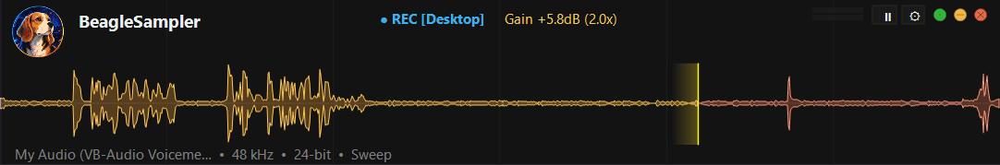
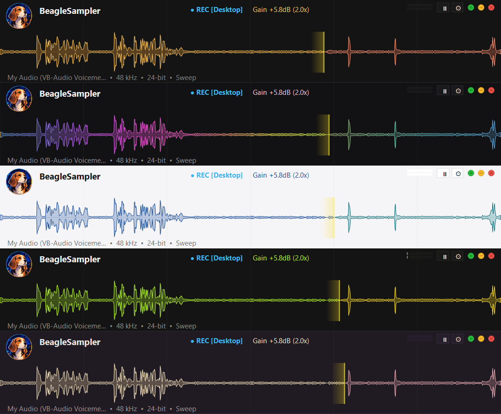
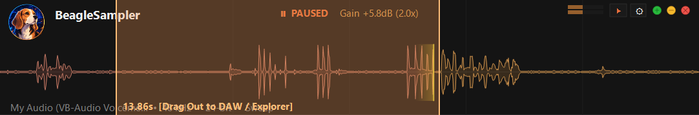

<div align="center">

# BeagleSampler 🐕🎧
### Real-Time Rolling Audio Sampler & DAW Plugin Suite for Windows

[](https://github.com/xsanikax/BeagleSampler/releases/latest)
[-0078D6?style=for-the-badge&logo=windows)](https://github.com/xsanikax/BeagleSampler/releases/latest)
[](https://github.com/xsanikax/BeagleSampler/releases/latest)
[](#technical-architecture)

<br/>

**Never lose an impromptu melody, jam session, synth patch, or sample again.**  
BeagleSampler continuously captures audio into a zero-latency circular buffer—allowing music producers, sound designers, and content creators to retroactively grab any sound from the past seconds or minutes, even if recording was never armed.

<br/>



</div>

---

## 🌟 Why BeagleSampler?

Traditional recording requires forethought: arming tracks, configuring inputs, and starting records. But creativity happens spontaneously.

* **Always Listening**: Captures high-definition 32-bit floating-point audio continuously from your desktop audio loopback (WASAPI) or microphone/interface inputs.
* **Instant Drag & Drop**: Highlight any phrase, bar, or sound directly on the waveform and drag it straight into your DAW (Ableton, FL Studio, REAPER, Bitwig, Cubase) or file manager as an instant `.WAV` file.
* **Ultra-Lightweight**: Built purely with native Win32/C++20 APIs—zero heavy frameworks, instant startup, sub-millisecond GUI latency, and negligible CPU footprint (< 0.5%).

---

## ✨ Features

### 🌊 Next-Gen Waveform Visualization Engine
* **Crisp Dual-Pass Aesthetics**: Precision 1.0px vivid stroke outline paired with a translucent infil (~30% opacity) where the dark interface background subtly shows through.
* **Mathematical Symmetrical Reflection**: Sample excursions are mirrored across the center baseline with exact phase symmetry and razor-thin 1.0px silence resolution.
* **Dual-Tone Sweep Mode**: Clear visual distinction between fresh audio (laid down on the current cycle) and older audio (prior cycle) as the playhead sweeps across the canvas.
* **Continuous Rolling Mode**: Oscilloscope-style right-to-left scrolling mode for real-time live monitoring.

### 🎛️ Sample Manipulation & Workflow
* **Instant Drag & Drop**: Select any region and drag it directly out of the window into DAW timeline tracks, sampler instruments, or Windows Explorer.
* **Smart Silence Trimming**: Optional automated silence detection and threshold trimming (-90 dB to -20 dB) removes empty air before and after takes.
* **Real-Time Display Gain**: Instantly zoom into quiet waveforms without destructive processing (up to +36 dB boost via `Ctrl + Mouse Wheel`).
* **Session Persistence**: Automatic state recovery saves your active buffer and settings so your audio is preserved even across computer reboots.
* **Automatic Silent Updates**: Built-in GitHub release checker automatically updates the application with a single click, adhering to GitHub rate-limit guidelines.

---

## 🎨 Theme Gallery

BeagleSampler features 5 high-contrast themes designed for low visual fatigue in studio environments:



1. **Carbon (Default)**: Deep obsidian background with warm amber-gold and terracotta coral tones.
2. **Rainbow**: Dynamic animated spectral cosine gradient shifting smoothly across the frequency spectrum.
3. **Bright**: Clean daylight-optimized palette featuring cobalt slate and deep ocean teal accents.
4. **Lemon**: High-energy electric chartreuse and sunny golden lemon yellow.
5. **Vintage**: Warm aesthetic tones blending sandstone cream with dusty rose mauve.

---

## 🖱️ Interactive Workflow

Highlighting and exporting audio takes less than two seconds:



1. **Click & Drag** anywhere on the timeline to create a selection.
2. The selection displays the precise region length (e.g., `13.86s`).
3. **Drag** directly out of the selection area into Ableton Live, FL Studio, REAPER, or any folder.
4. Press `P` to audition the selection, or `Space` to freeze and examine details.

---

## ⌨️ Controls & Shortcuts

| Action | Control / Shortcut | Description |
| :--- | :--- | :--- |
| **Pause / Resume** | <kbd>Space</kbd> or Pause Button | Freezes the buffer for close inspection without dropping audio |
| **Create Selection** | <kbd>Left Click + Drag</kbd> | Marks start and end boundaries for export |
| **Export to DAW** | <kbd>Click Selection + Drag Out</kbd> | Drags audio out as a standard `.wav` file |
| **Audition Selection** | <kbd>P</kbd> | Plays back the selected region (or full buffer) |
| **Select All** | <kbd>Ctrl</kbd> + <kbd>A</kbd> | Expands selection across the entire recorded buffer |
| **Deselect** | <kbd>Esc</kbd> or <kbd>Right Click</kbd> | Clears current selection and returns to live monitoring |
| **Adjust Gain** | <kbd>Ctrl</kbd> + <kbd>Mouse Wheel</kbd> | Increases / decreases waveform visual zoom (-inf to +36 dB) |
| **Clear Buffer** | <kbd>C</kbd> or <kbd>Delete</kbd> | Flushes buffer memory and restarts capture cycle |
| **Cycle Theme** | <kbd>T</kbd> | Cycles through Carbon, Rainbow, Bright, Lemon, and Vintage |
| **Cycle Display Mode** | <kbd>M</kbd> | Switches between Sweep (Playhead) and Rolling (Oscilloscope) |
| **Target Framerate** | <kbd>F</kbd> | Toggles refresh rate between 60, 30, 20, and 15 FPS |
| **Context Menu** | <kbd>Right Click</kbd> or Settings Gear | Select audio input device, duration (15s–5m), trimming, and options |

---

## 📦 Download & Installation

> [!TIP]
> **Zero Dependencies Required:** BeagleSampler is 100% self-contained and statically linked. It does **not** require installing Visual C++ Redistributables, compilers, .NET, or any external frameworks. The installer works immediately on any 64-bit Windows 10 or 11 system out of the box.

Grab the latest installer or standalone portable executable from the **[Releases Page](https://github.com/xsanikax/BeagleSampler/releases/latest)**:

| Distribution File | Description |
| :--- | :--- |
| **`BeagleSampler_Setup.exe`** | **Recommended.** Self-contained installer wizard with component selection (Standalone, VST3, CLAP) and maintenance uninstaller. |
| **`BeagleSampler.exe`** | Standalone portable executable. No installation required. Runs anywhere. |
| **`BeagleSampler.vst3`** | 64-bit VST3 plugin for Ableton Live, FL Studio, Cubase, Studio One, REAPER. |
| **`BeagleSampler.clap`** | 64-bit CLAP plugin for Bitwig Studio, REAPER, and next-gen hosts. |

### Default Installation Paths
* **Standalone**: `C:\Program Files\BeagleSampler\BeagleSampler.exe`
* **VST3 Plugin**: `C:\Program Files\Common Files\VST3\BeagleSampler.vst3`
* **CLAP Plugin**: `C:\Program Files\Common Files\CLAP\BeagleSampler.clap`

---

## 🛠️ Building from Source (Developers Only)

> [!NOTE]
> End users and music producers **do NOT need any of these developer tools**. Simply download and run the pre-compiled [`BeagleSampler_Setup.exe`](https://github.com/xsanikax/BeagleSampler/releases/latest).  
> The instructions below are strictly for software developers who wish to modify and compile the C++ source code.

### Developer Build Prerequisites
* Windows 10 / 11 (64-bit)
* Modern C++20 compiler (`clang++`, `g++`, or MSVC `cl.exe`)
* [CMake](https://cmake.org/) (version 3.20 or newer)
* [Ninja](https://ninja-build.org/) build tool

### Build Instructions

```powershell
# 1. Clone repository with submodules
git clone https://github.com/xsanikax/BeagleSampler.git
cd BeagleSampler

# 2. Configure build with Ninja
cmake -B build -G Ninja -DCMAKE_BUILD_TYPE=Release

# 3. Build standalone application, plugins, and installer
ninja -C build

# 4. Run automated test suite
.\build\test_buffer.exe
.\build\test_plugins.exe
```

---

## 🏛️ Technical Architecture

* **Lock-Free Audio Ring Buffer**: High-throughput single-producer single-consumer circular buffer with monotonic sample timestamps, wrap-around tracking, and block-accelerated min/max peak decimation caches.
* **Low-Latency Direct Capture**: Native WASAPI loopback client capturing bit-perfect shared-mode render streams, with automatic resampling and channel format normalization.
* **Double-Buffered Back-Buffer Canvas**: Windows GDI/GDI+ back-buffer with per-monitor DPI v2 awareness, zero redraw flicker, and sub-millisecond render passes.
* **Self-Contained Single Executable Architecture**: Portable executable embeds all icons, manifests, and high-resolution logo assets directly into Windows PE resource tables.

---

## 📄 License

Developed by **BeagleBoss**. All rights reserved.
